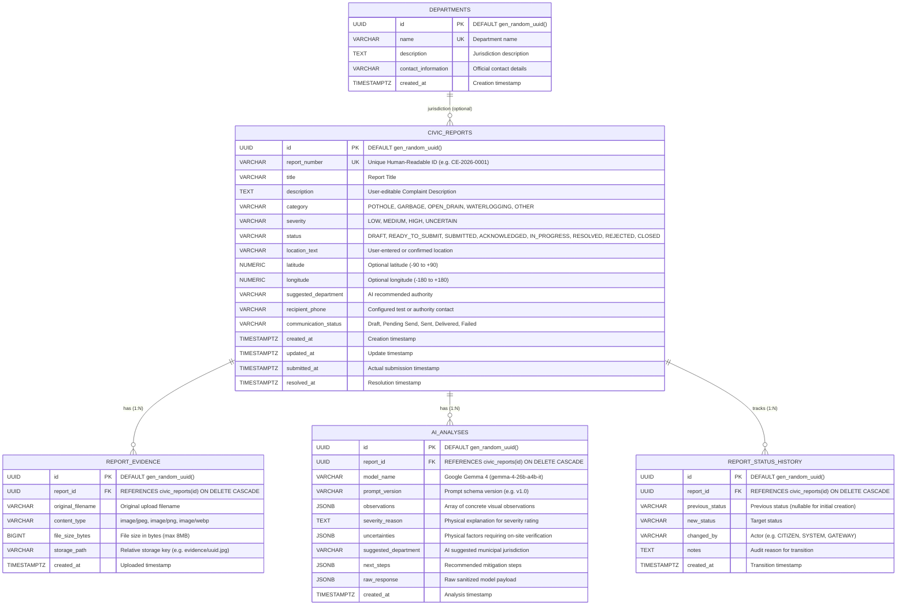

# CivicEye Normalized PostgreSQL Database Schema Specification

This document details the complete, normalized PostgreSQL schema implemented for **CivicEye**, including table structures, relationships, data integrity constraints, state transition rules, and Flyway migrations.

---

## 1. Entity-Relationship Diagram (ERD)



---

## 2. Table Definitions & Constraints

### 2.1 Table: `civic_reports`
Stores the central civic grievance and its lifecycle state.

```sql
CREATE TABLE civic_reports (
    id UUID PRIMARY KEY DEFAULT gen_random_uuid(),
    report_number VARCHAR(50) NOT NULL UNIQUE,
    title VARCHAR(255) NOT NULL,
    description TEXT NOT NULL,
    category VARCHAR(50) NOT NULL CHECK (category IN ('POTHOLE', 'GARBAGE', 'OPEN_DRAIN', 'WATERLOGGING', 'OTHER')),
    severity VARCHAR(50) NOT NULL DEFAULT 'UNCERTAIN' CHECK (severity IN ('LOW', 'MEDIUM', 'HIGH', 'UNCERTAIN')),
    status VARCHAR(50) NOT NULL DEFAULT 'DRAFT' CHECK (status IN ('DRAFT', 'READY_TO_SUBMIT', 'SUBMITTED', 'ACKNOWLEDGED', 'IN_PROGRESS', 'RESOLVED', 'REJECTED', 'CLOSED')),
    location_text VARCHAR(500),
    latitude NUMERIC(10, 6),
    longitude NUMERIC(10, 6),
    suggested_department VARCHAR(255),
    recipient_phone VARCHAR(50),
    communication_status VARCHAR(50) DEFAULT 'Draft',
    created_at TIMESTAMPTZ NOT NULL DEFAULT CURRENT_TIMESTAMP,
    updated_at TIMESTAMPTZ NOT NULL DEFAULT CURRENT_TIMESTAMP,
    submitted_at TIMESTAMPTZ,
    resolved_at TIMESTAMPTZ
);
```

#### Query Optimization Indexes:
- `CREATE UNIQUE INDEX idx_civic_reports_report_number ON civic_reports(report_number);`
- `CREATE INDEX idx_civic_reports_status ON civic_reports(status);`
- `CREATE INDEX idx_civic_reports_category ON civic_reports(category);`
- `CREATE INDEX idx_civic_reports_created_at ON civic_reports(created_at DESC);`
- `CREATE INDEX idx_civic_reports_location_text ON civic_reports(location_text);`

### 2.2 Table: `report_evidence`
Stores metadata for uploaded photographs. Large binaries are stored on the filesystem or S3 storage path; only the relative storage reference is retained in the database.
```sql
CREATE TABLE report_evidence (
    id UUID PRIMARY KEY DEFAULT gen_random_uuid(),
    report_id UUID NOT NULL REFERENCES civic_reports(id) ON DELETE CASCADE,
    original_filename VARCHAR(255) NOT NULL,
    content_type VARCHAR(100) NOT NULL,
    file_size_bytes BIGINT NOT NULL,
    storage_path VARCHAR(500) NOT NULL,
    created_at TIMESTAMPTZ NOT NULL DEFAULT CURRENT_TIMESTAMP
);
CREATE INDEX idx_report_evidence_report_id ON report_evidence(report_id);
```

### 2.3 Table: `ai_analyses`
Preserves historical Gemma 4 analyses. When a citizen reruns analysis with improved photos or descriptions, previous records are retained in an immutable log.
```sql
CREATE TABLE ai_analyses (
    id UUID PRIMARY KEY DEFAULT gen_random_uuid(),
    report_id UUID NOT NULL REFERENCES civic_reports(id) ON DELETE CASCADE,
    model_name VARCHAR(100) NOT NULL,
    prompt_version VARCHAR(50) NOT NULL DEFAULT 'v1.0',
    observations JSONB NOT NULL DEFAULT '[]'::jsonb,
    severity_reason TEXT,
    uncertainties JSONB DEFAULT '[]'::jsonb,
    suggested_department VARCHAR(255),
    next_steps JSONB DEFAULT '[]'::jsonb,
    raw_response JSONB,
    created_at TIMESTAMPTZ NOT NULL DEFAULT CURRENT_TIMESTAMP
);
CREATE INDEX idx_ai_analyses_report_id ON ai_analyses(report_id);
```

### 2.4 Table: `report_status_history`
Maintains an immutable audit log of legitimate lifecycle status transitions.
```sql
CREATE TABLE report_status_history (
    id UUID PRIMARY KEY DEFAULT gen_random_uuid(),
    report_id UUID NOT NULL REFERENCES civic_reports(id) ON DELETE CASCADE,
    previous_status VARCHAR(50),
    new_status VARCHAR(50) NOT NULL,
    changed_by VARCHAR(100),
    notes TEXT,
    created_at TIMESTAMPTZ NOT NULL DEFAULT CURRENT_TIMESTAMP
);
CREATE INDEX idx_report_status_history_report_id ON report_status_history(report_id);
```

---

## 3. Lifecycle Status State Machine

The service layer (`CivicReportService`) strictly enforces the following transition rules:

| Current Status | Permitted Next States | Business Meaning |
| :--- | :--- | :--- |
| `DRAFT` | `READY_TO_SUBMIT`, `REJECTED`, `CLOSED` | Report freshly created by citizen; awaiting AI review or photo confirmation. |
| `READY_TO_SUBMIT` | `DRAFT`, `SUBMITTED`, `REJECTED`, `CLOSED` | AI draft verified; ready for messaging dispatch or official filing. |
| `SUBMITTED` | `ACKNOWLEDGED`, `IN_PROGRESS`, `REJECTED`, `CLOSED` | Grievance successfully delivered to messaging adapter or ward authority. |
| `ACKNOWLEDGED` | `IN_PROGRESS`, `REJECTED`, `CLOSED` | Ward office or municipal department received and logged the grievance. |
| `IN_PROGRESS` | `RESOLVED`, `REJECTED`, `CLOSED` | Repair crew deployed on-site (e.g. asphalt patching or drain clearing). |
| `RESOLVED` | `CLOSED`, `IN_PROGRESS` | Work completed. Re-opens to `IN_PROGRESS` if citizen confirms `NOT_FIXED`. |
| `REJECTED` | `DRAFT`, `CLOSED` | Duplicate or invalid issue. Can be revised back to `DRAFT`. |
| `CLOSED` | `DRAFT` | Final archive state. Can only be re-opened by creating a new investigation. |

---

## 4. Flyway Database Migrations

Database schema migrations are managed via **Flyway**:
- **Location**: `backend/src/main/resources/db/migration/`
- **Initial Migration**: `V1__create_civic_report_tables.sql`
- **Configuration** in `application.properties`:
  ```properties
  spring.flyway.enabled=true
  spring.flyway.baseline-on-migrate=true
  spring.flyway.locations=classpath:db/migration
  spring.jpa.hibernate.ddl-auto=validate
  ```
Flyway automatically executes pending migrations upon Spring Boot startup, creating all required tables and indexes idempotently.
